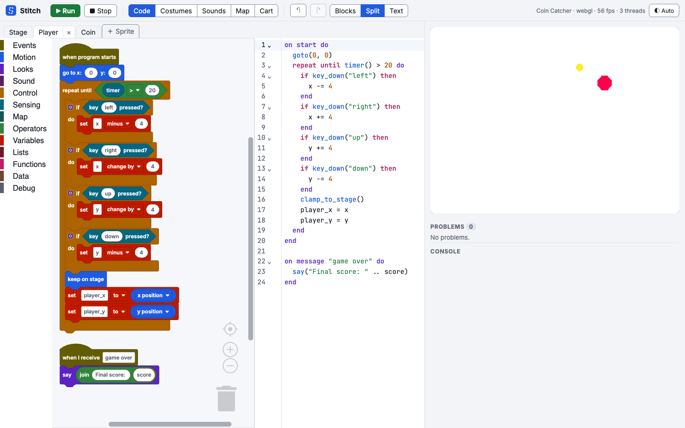

<p align="center"></p>

<h1 align="center">Stitch</h1>

<p align="center">Make games in the browser with blocks or code: a faster Scratch with PICO-8-style carts.</p>

<picture>
  <source media="(prefers-color-scheme: dark)" srcset="docs/images/editor-dark.png">
  
</picture>

## What it is

- **Blocks and text are the same program.** Drag blocks or type Lua-flavoured code; both views edit one program and stay in sync as you work. Every block has exactly one text spelling.
- **Fast.** Scripts compile to JavaScript and run as green threads at a fixed 60 ticks a second, so 1,000 moving sprites hold 60 fps (measured on an M2 laptop).
- **Carts.** A whole game (code, pixel and vector art, a tile map, sfxr sound effects, tracker music and extensions) is one `.stitch.png` file whose picture is the game's cover.
- **Safe to run.** Games run in a sandboxed frame. Web requests go through a permission prompt, and API keys you set stay in your browser, never in a cart.
- **Share anywhere.** Export a single HTML file, an installable offline web app, or a desktop app project.
- **Familiar.** Scratch's stage, coordinates and blocks, with each deliberate difference [written down](docs/departures.md).

## Quick start

You need Node 22+ and pnpm 10 (`corepack enable`).

```sh
pnpm install
pnpm dev
```

Open `http://localhost:5173`. The editor starts with a sample game: press **Run** and use the arrow keys. **Cart → Samples** has bigger ones, with comments throughout for reading: **Stitch Dungeon**, a roguelike with procedurally generated floors, enemies as clones and a pen-drawn HUD and minimap; **Patch Hop**, a three-level platformer with tile collisions and stomping; and **Needle Storm**, a bullet hell against a three-phase boss. Then follow a tutorial:

- [Your first game, for Scratch users](docs/tutorials/first-game-scratch.md): blocks first.
- [Your first game, for PICO-8 users](docs/tutorials/first-game-pico8.md): text first, with a tile map.

`pnpm build` writes a static site to `packages/editor/dist`, which any static host can serve ([hosting notes](docs/export.md#hosting-the-editor)).

## Documentation

| | |
|---|---|
| [Language reference](docs/reference.md) | Every keyword, block and builtin, text and blocks side by side |
| [Exporting and sharing](docs/export.md) | HTML, web app and desktop exports; CORS and secrets |
| [Network, secrets and CORS](docs/network.md) | How HTTP from games works, and the threat model |
| [Writing an extension](docs/extensions.md) | Add your own blocks |
| [Cart format](docs/cart-format.md) | The file format, versions and PNG container |
| [Architecture](docs/architecture.md) | How the packages fit together |
| [Departures from Scratch](docs/departures.md) | Every deliberate difference, with reasons |
| [Roadmap](docs/plan.md) | Phases, open decisions and known gaps |
| [Contributing](CONTRIBUTING.md) | Setup, checks and conventions |
| API docs | `pnpm docs:api`, then open `docs/api/index.html` |

## Commands

| Command | |
|---|---|
| `pnpm dev` | The editor with hot reload |
| `pnpm build` | Production build of the editor |
| `pnpm test` | Node tests, including the docs and design checks |
| `pnpm test:browser` | WebGL pixel tests and Blockly round-trips in headless Chromium |
| `pnpm typecheck` · `pnpm lint` | TypeScript and ESLint |
| `pnpm check:licenses` · `pnpm check:size` | License allow-list; exported player size budget |
| `pnpm gen` | Regenerate the parser after a grammar change |
| `pnpm docs:blocks` · `pnpm docs:api` | Render docs block pictures; build API docs |

The benchmark is at `/bench.html?n=1000`. The desktop editor is in [`desktop/`](desktop/README.md).

## Status

Phases 1–9 of the [roadmap](docs/plan.md) are built: language, blocks, assets and carts, audio, APIs and extensions, export, visual design, documentation, and block parity with Scratch 3 (clones, pen, sensing, dictionaries and more). The desktop builds haven't been compiled yet; [known gaps](docs/plan.md#known-gaps) lists what's left.

Dependencies that ship are MIT, Apache-2.0, BSD, ISC or 0BSD licensed, apart from the Inter and JetBrains Mono fonts (SIL OFL 1.1).
