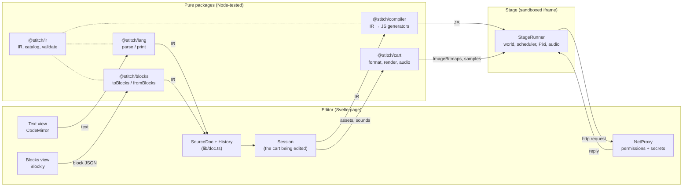

# Architecture

How Stitch fits together, for people reading or changing its code. The binding rules are the architecture rules in [`CLAUDE.md`](../CLAUDE.md); this page explains them and links there rather than restating every detail.

## The big picture

Exports reuse the right-hand side: an exported game is the cart's sources plus the compiled JS, run by the same `StageRunner` in a standalone page ([export.md](export.md)).

## One IR, two editors

The program's source of truth is a typed tree, the **IR** (`packages/ir/src/nodes.ts`). Text and blocks are two editors of it:

- **Text → IR:** a Lezer grammar (`packages/lang/src/stitch.grammar`) parses text; `lower.ts` turns the syntax tree into IR. Unparseable text becomes a `Raw` node holding its exact text, so nothing is lost.
- **IR → text:** `print` writes one canonical spelling. `print(parse(t))` is a fixed point, and comments and blank lines survive as `Trivia`.
- **IR ↔ blocks:** `toBlocks` and `fromBlocks` are pure converters to and from Blockly's JSON, tested in Node. Every IR shape has exactly one block, and a block's id is its IR node's id. Only `workspace.ts` touches Blockly itself.
- **Sync** (`editor/src/lib/doc.ts`): a text edit re-parses, then `reconcile` carries the old node ids over so blocks keep their identity and position. A block edit goes through `fromBlocks`, is printed, and is parsed again, so both views always hold the same canonical program. One undo history covers both.

Positions (source spans, block coordinates) live in side tables, never in IR nodes, so the IR carries only meaning.

## The catalog

Every command and reporter is an entry in one registry, the builtin catalog (`packages/ir/src/builtins.ts`). The validator, compiler, block definitions, toolbox, linter and docs check all read it. Extensions add entries per cart through `createCatalog`, and can't shadow core names. Adding a builtin means a catalog entry, a runtime implementation, a block label and a [reference entry](reference.md); tests fail until all four exist.

## Compiler and runtime

`@stitch/compiler` turns each file's IR into JavaScript. Every event script and function becomes a **generator**, and every loop iteration ends in `yield` (except in `warp` functions), so the runtime can run thousands of scripts as green threads:

- The scheduler (`runtime/src/core/scheduler.ts`) steps each thread once per tick, 60 times a second (`core/loop.ts`).
- Time is counted in ticks, never the wall clock, so runs are deterministic.
- Builtins that wait (`wait`, `say_for`, `http_get`) are generators too; a network reply settles a promise that the waiting thread checks each tick.

All coordinate maths goes through `runtime/src/core/space.ts`, which applies the cart's stage settings (size, origin, y direction). Rendering is Pixi.js (WebGL or WebGPU) behind a small `Renderer` interface, and audio is Web Audio behind `AudioOut`. Tests swap in `NullRenderer`, `NullAudio` and `NullNet`, so compiled programs run in Node.

## The sandbox

The game runs in an `<iframe sandbox="allow-scripts">` with an opaque origin and a strict Content Security Policy (`default-src 'none'`, `connect-src 'none'`). It talks to the editor only through typed `postMessage` messages (`runtime/src/protocol.ts`):

- The editor sends the compiled program, costumes as `ImageBitmap`s and sounds as sample buffers. The stage never fetches or synthesizes anything itself.
- The stage sends logs, errors, stats and HTTP requests. The editor's `NetProxy` asks the user once per host, adds secrets, fetches, scrubs secrets from the reply and answers.

Extension code runs in the stage too, so it gets the same limits. The threat model is in [network.md](network.md).

## Carts

A cart (`packages/cart`) holds sources, not caches: pixel layers, SVG text, sfxr parameters and tracker patterns. `@stitch/cart/render` and `@stitch/cart/audio` turn them into images and samples deterministically, for the editor, the stage and exports alike. The format, versions and PNG container are in [cart-format.md](cart-format.md).

## Packages

| Package | What it holds | Runs in |
|---|---|---|
| `ir` | IR types, catalog, validation, reconcile, shared test generators | anywhere |
| `lang` | Grammar, parse, print, CodeMirror language support | anywhere |
| `compiler` | IR → JavaScript | anywhere |
| `runtime` | Scheduler, world, builtins, Pixi stage, audio, `StageRunner`, `FetchNet` | browser (core is pure) |
| `cart` | Cart format, stage settings, pixel, map, sfx and music data, renderers, PNG container | anywhere (`/render` needs a browser) |
| `blocks` | Block definitions, IR ↔ block JSON, toolbox, colours, Blockly glue | anywhere (`/workspace` needs a browser) |
| `export` | Exported game format, HTML/PWA/Tauri writers, the player bundle | anywhere (the player is browser code) |
| `editor` | The Svelte app: `index.html`, `stage.html`, `bench.html` | browser |

`desktop/` wraps the built editor in a Tauri 2 shell. Generated API docs for every package come from their TSDoc comments: `pnpm docs:api` writes them to `docs/api/`.

## Where to read next

- [`CLAUDE.md`](../CLAUDE.md): the architecture rules, conventions and commands.
- [plan.md](plan.md): what each phase built, open decisions and known gaps.
- [departures.md](departures.md): every deliberate difference from Scratch, with its reason.
- [CONTRIBUTING.md](../CONTRIBUTING.md): setting up, testing and sending changes.
