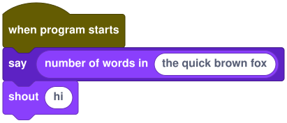

# Writing an extension

An extension adds blocks to Stitch: new commands and reporters, in their own toolbox category and colour, with a text spelling like any builtin. It's two files, a JSON **manifest** that describes the blocks and a JavaScript **script** that implements them. Both are saved inside the cart that uses them, so the cart keeps working anywhere, and the code never has to be fetched again.

The editor only ever reads the manifest. The script runs in the sandboxed stage, alongside the game, with no access to the editor, your secrets or the network except through Stitch's permission prompt. How extensions differ from Scratch and TurboWarp extensions is [D22](departures.md).

## A complete example

This extension adds two blocks: a reporter that counts the words in some text and a command that logs a message.

**`manifest.json`**

<!-- manifest -->
```json
{
  "id": "words",
  "name": "Words",
  "version": "1.0.0",
  "description": "Counting and shouting.",
  "color": "#8a3ffc",
  "main": "words.js",
  "blocks": [
    {
      "name": "words_count",
      "kind": "reporter",
      "label": "number of words in %1",
      "params": [{ "name": "text", "type": "string", "default": "one two three" }],
      "returns": "number"
    },
    {
      "name": "words_shout",
      "kind": "command",
      "label": "shout %1",
      "params": [{ "name": "text", "type": "string", "default": "hello" }]
    }
  ]
}
```

**`words.js`**

```js
stitch.define('words_count', (text) => String(text).split(/\s+/).filter(Boolean).length);

stitch.define('words_shout', (text, ctx) => {
  stitch.log(`${ctx.sprite.name} shouts ${String(text).toUpperCase()}!`);
});
```

Serve both files from any web server that allows cross-origin requests (`npx http-server --cors` works), then in the editor choose **Cart → Extensions → Add from URL…** and enter the manifest's URL. You can also pick both files with **Add from files…**. The blocks appear in a **Words** category, and in text:

<!-- example: ext-words -->
```stitch
on start do
  say(words_count("the quick brown fox"))
  words_shout("hi")
end
```



The editor ships a working sample at `/extensions/text/manifest.json` ([source](../packages/editor/public/extensions/text)).

## Manifest

| Field | Rules |
|---|---|
| `id` | Lowercase letters and digits, starting with a letter, at most 24 characters. Unique within the cart |
| `name` | The toolbox category, and the name in **Cart → Extensions** |
| `version` | Any text; shown in the Cart tab. Adding an extension whose `id` is already installed asks before replacing it |
| `description` | Optional |
| `color` | `#rrggbb`, used for the blocks and the category. Pick a colour dark enough for white text (4.5:1); the core palette is in `blocks/src/definitions.ts` |
| `main` | The script's URL, relative to the manifest. Used by **Add from URL** |
| `blocks` | The blocks, in toolbox order |

Each block:

| Field | Rules |
|---|---|
| `name` | An identifier starting with `<id>_`, and not a core builtin. It's also the block's text spelling: `words_count(…)` |
| `kind` | `command` (a statement) or `reporter` (a value) |
| `label` | Block text. `%1`…`%n` place the parameters, each exactly once, in any order (`"replace %2 with %3 in %1"`) |
| `description` | Optional. One sentence for the code editor's hover docs and completion list; without it they show the block text |
| `params` | Each has a `name`, an optional `type` (`number`, `string`, `boolean`, `list` or `any`, default `any`) and an optional `default`, the value the toolbox shows |
| `returns` | Reporters only: the value type, default `any` |
| `waits` | `true` if the implementation returns a Promise; the calling script waits for it while other scripts keep running |

A manifest that breaks a rule is refused with a list of what's wrong. Extension blocks never shadow core names, so a cart's own extensions can't change what `move` does.

## Script

The script is the body of a function that receives one argument, `stitch`. It runs once at the start of every **Run**, in the stage, before any event script, so a fresh run never sees state from the last one.

| API | |
|---|---|
| `stitch.define(name, fn)` | Implements a manifest block. `fn` receives the block's arguments, then a `ctx` object. Every manifest block must be defined |
| `ctx.sprite` | A read-only snapshot of the calling sprite: `name`, `x`, `y`, `direction`, `size`, `visible`, `costume` |
| `stitch.log(text)` | Prints to the **Console** as `extension <id>` |
| `stitch.http(method, url, body?)` | `GET` or `POST` through the same permission prompt, limits and secrets as [`http_get`](reference.md#http_geturl--reporter-waits). Resolves to `{ status, body }` |

Values crossing between Stitch and the script:

- Arguments arrive as numbers, strings, booleans or arrays (copies of Stitch lists).
- Return values become Stitch values: numbers, strings and booleans as they are, arrays as lists, `null` and `undefined` as `""`, and other objects as JSON text.
- A block marked `waits` may return a Promise. One that isn't must return a plain value.
- An exception shows in the **Console** under the extension's id and stops the calling script, as a runtime error does.

## Limits

- The script can't use `fetch` or `XMLHttpRequest`: the stage's Content Security Policy blocks every connection. Use `stitch.http`, which goes through the editor's host prompt, adds secrets for hosts that have them, and scrubs those secrets from replies.
- It can't reach the editor, the `World` or other sprites' state, only what `ctx` and its arguments give it.
- It shares the stage window with the game, so it could draw over the stage or post fake log lines. Only add extensions you trust (see [network.md](network.md) for the threat model).
- Blocks are plain commands and reporters for now: no hats, dropdown menus or custom shapes.

## Exported games

Exports include each extension's manifest and script, and run them the same way. In an exported game `stitch.http` fetches directly, asks the player once per host, and never has secrets. See the [export guide](export.md).
