# Language reference

Every keyword, block and builtin in Stitch. Each entry shows the text on the left and the same program as blocks on the right. Both are drawn from one source: the text is parsed, turned into blocks with `toBlocks` and rendered in real Blockly (`pnpm docs:blocks`), so they can't drift apart.

Short examples are statements; in a program they sit inside an event script or a function. Where Stitch behaves differently from Scratch, the entry links to its row in [departures.md](departures.md). For extensions, see the [extension guide](extensions.md); for the cart file, see [cart-format.md](cart-format.md).

- [Programs and files](#programs-and-files)
- [Values](#values)
- [Variables](#variables) · [Variable kinds](#variable-kinds) · [Built-in variables](#built-in-variables)
- [Events](#events)
- [Control](#control)
- [Functions](#functions)
- [Operators](#operators)
- [Motion](#motion) · [Looks](#looks) · [Sound](#sound) · [Messages](#messages) · [Timing](#timing) · [Clones](#clones) · [Sensing](#sensing) · [Map](#map) · [Pen](#pen) · [Math](#math) · [Lists and text](#lists-and-text) · [Text](#text) · [Grids and dictionaries](#grids-and-dictionaries) · [Data](#data) · [Debug](#debug)
- [Raw code](#raw-code)
- [Keywords](#keywords)

## Programs and files

A cart has one file for the **Stage** and one per sprite. Each file is a list of items: variable declarations, functions and event scripts. Statements only appear inside a script or function. The Stage file is the place for global variables and scripts that belong to no sprite.

Text and blocks are two views of the same program. Editing either one updates the other. A block edit rewrites the text in one canonical layout (two-space indents, one statement per line), the way `gofmt` does for Go. **Format** (⇧⌥F, and on save unless it's turned off under ⚙) does the same for text you type, and also puts a blank line around each script and function. Comments start with `--` and run to the end of the line; they're kept where they are, and appear as block comments.

While you type, the code view suggests what fits where the cursor is: statements and commands at the start of a line, reporters and variables in an expression, and inside a string the cart's own sprite, costume, sound, song and message names. Every suggestion and hover shows the entry from this reference, with its block. **F12** (or ⌘-click) goes to where a variable or function is declared.

<!-- generated: programs-and-files -->

### Comments

A comment above an item or statement is attached to its block. A comment at the end of a line stays at the end of that line in text.

<table><tr><td>

<!-- example: comment -->
```stitch
-- Spin slowly, forever.
on start do
  forever do
    turn(1) -- one degree per tick
  end
end
```

</td><td>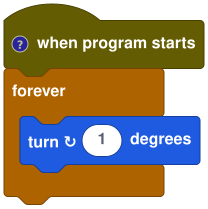</td></tr></table>

<!-- /generated -->

## Values

| Kind | Text | Notes |
|---|---|---|
| Number | `42`, `3.5` | Floats. Division by zero gives `Infinity`, as in Scratch |
| String | `"hello"` | Double quotes; `\"` and `\\` escape |
| Boolean | `true`, `false` | `and`, `or`, `not` and comparisons give booleans ([D11](departures.md)) |
| List | `[1, 2, "three"]` | 1-based. A variable can hold a list, and lists are shared, not copied ([D9](departures.md)) |
| Dictionary | `dict()` | Text keys to any values: `d["hp"] = 3`, `d["hp"]`. Shared, not copied, like lists. See [Grids and dictionaries](#grids-and-dictionaries) ([D30](departures.md)) |

Values convert as Scratch's do: `"10" + 5` is `15`, text that isn't a number counts as `0` in arithmetic, and `"10" == 10` is true. Text comparison is case-sensitive ([D7](departures.md)).

<!-- generated: values -->

### Numbers, strings and booleans

Literal values fill block slots.

<table><tr><td>

<!-- example: literals -->
```stitch
say_for("Ready?", 1.5)
show()
if true then
  say(42)
end
```

</td><td>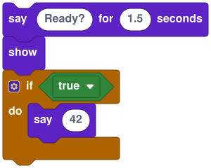</td></tr></table>

### `[a, b, …]` — list

Makes a new list. In blocks it's the *create list with* reporter, with a gear to add or remove slots.

<table><tr><td>

<!-- example: list-literal -->
```stitch
var fruit = ["apple", "pear", "fig"]
```

</td><td>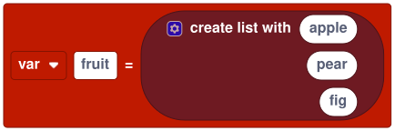</td></tr></table>

### `list[i]` — item

Reads item `i` (from 1) of a list, or character `i` of a string. Out of range gives `""`.

<table><tr><td>

<!-- example: index -->
```stitch
say(fruit[2])
```

</td><td>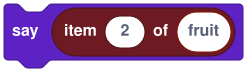</td></tr></table>

<!-- /generated -->

## Variables

<!-- generated: variables -->

### `var` — sprite variable

Declares a variable at the top of a file. In a sprite file each sprite has its own copy, and so does each of its clones, which start with their parent's value (Scratch's "for this sprite only"). In the Stage file it belongs to the stage. The starting value can't wait or call your own functions.

<table><tr><td>

<!-- example: var -->
```stitch
var lives = 3
var speed = 2.5
```

</td><td>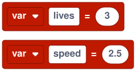</td></tr></table>

### `global var` — global variable

Shared by every sprite and the stage. Declare it in any file (usually the Stage); every file can read and write it. If two files declare the same global, the first value wins.

<table><tr><td>

<!-- example: global-var -->
```stitch
global var score = 0
```

</td><td></td></tr></table>

### `shared var` — shared by a sprite and its clones

One value for a sprite and all of its clones: when any of them changes it, they all see the change. Use it for things the whole family counts, like how many enemies are left. Scratch has no such scope ([D26](departures.md)).

<table><tr><td>

<!-- example: shared-var -->
```stitch
shared var alive = 0

on clone do
  alive += 1
end
```

</td><td>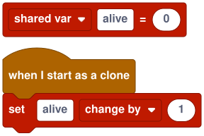</td></tr></table>

### `local` — local variable

Declares a variable that lives until the end of the enclosing block (script, loop body or `if` branch).

<table><tr><td>

<!-- example: local -->
```stitch
local half = size / 2
say(half)
```

</td><td>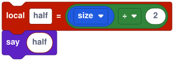</td></tr></table>

### `=`, `+=`, `-=`, `*=`, `/=` — set and change

Assigns to a variable, a sprite property or a list item. In blocks the operator is a dropdown: *to*, *change by* (`+=`), *minus*, *times* and *divided by*.

<table><tr><td>

<!-- example: assign -->
```stitch
lives = 3
score += 10
speed *= 0.9
```

</td><td>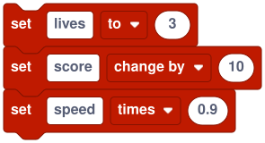</td></tr></table>

### `list[i] = value` — replace item

Replaces item `i` of a list. Out of range does nothing, as in Scratch. Indexes can be chained (`grid[2][3] = 1`).

<table><tr><td>

<!-- example: set-index -->
```stitch
fruit[1] = "plum"
```

</td><td>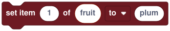</td></tr></table>

### Sprite properties

`x`, `y`, `direction` and `size` are the sprite's own position, direction (degrees, 0 = up, 90 = right) and size in percent. Read them like variables and assign them like variables. `costume_number` is read-only. They are reserved names, so they can't be declared as variables.

<table><tr><td>

<!-- example: props -->
```stitch
x += 5
direction = 180
size = 150
say(costume_number)
```

</td><td>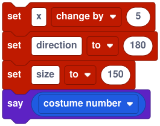</td></tr></table>

<!-- /generated -->

## Variable kinds

Every kind of variable a program can make, one example each. Text and blocks are the same program; the Examples cart (**Cart → Samples → Examples**) runs them all on the stage.

<!-- generated: variable-kinds -->

### Global: one value for everyone

A `global var` is shared by the stage and every sprite and clone. Use it for the score, the level, or anything the whole game needs.

<table><tr><td>

<!-- example: kind-global -->
```stitch
global var score = 0

on message "coin" do
  score += 1
end
```

</td><td>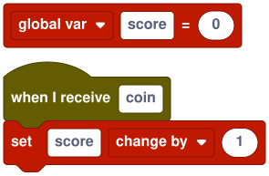</td></tr></table>

### Per sprite: one value per sprite family

A `shared var` in a sprite file has one value for the sprite and all of its clones together, so the family can count things like how many enemies are left.

<table><tr><td>

<!-- example: kind-sprite -->
```stitch
shared var enemies = 0

on clone do
  enemies += 1
end
```

</td><td>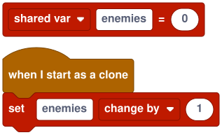</td></tr></table>

### Per clone: one value each

A plain `var` in a sprite file belongs to that sprite, and each clone gets its own copy, starting from its parent's value. Change it in the clone and only that clone sees it.

<table><tr><td>

<!-- example: kind-clone -->
```stitch
var hp = 3

on clone do
  hp = random_int(1, 5)
  say(hp)
end
```

</td><td>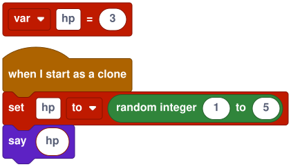</td></tr></table>

### Local: only inside one block

A `local` lives until the end of the script, loop body or branch that declares it. Each run of the script gets a fresh one.

<table><tr><td>

<!-- example: kind-local -->
```stitch
on start do
  local total = 0
  for i = 1, 10 do
    total += i
  end
  say(total)
end
```

</td><td>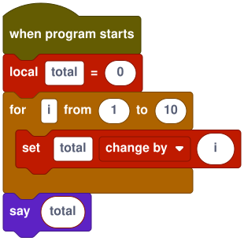</td></tr></table>

### List: items in order

Any variable can hold a list. Items are numbered from 1, and `push` adds to the end.

<table><tr><td>

<!-- example: kind-list -->
```stitch
var path = []

on start do
  push(path, x)
  push(path, y)
  say(len(path))
end
```

</td><td>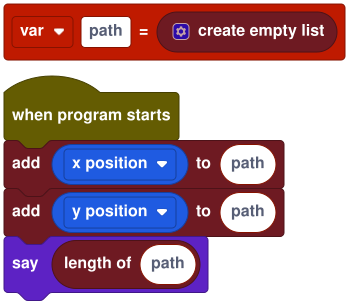</td></tr></table>

### Grid: a list of rows

A 2D grid is a list of rows, made with `make_grid` and read and written by column and row with `cell` and `set_cell`.

<table><tr><td>

<!-- example: kind-grid -->
```stitch
var board = make_grid(8, 8, 0)

on start do
  set_cell(board, 3, 2, 1)
  say(cell(board, 3, 2))
end
```

</td><td>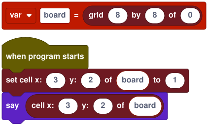</td></tr></table>

### Dictionary: values by name

A dictionary maps text keys to values. Make one with `dict()` and index it with a key.

<table><tr><td>

<!-- example: kind-dict -->
```stitch
var stats = dict()

on start do
  stats["hp"] = 10
  stats["name"] = "Knight"
  say(stats["name"] .. " " .. stats["hp"])
end
```

</td><td>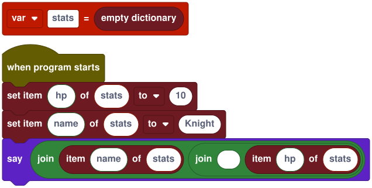</td></tr></table>

### Function with a return value

A function that ends in `return` is a reporter: call it inside an expression to use its value.

<table><tr><td>

<!-- example: kind-function -->
```stitch
function double(n)
  return n * 2
end

on start do
  say(double(21))
end
```

</td><td>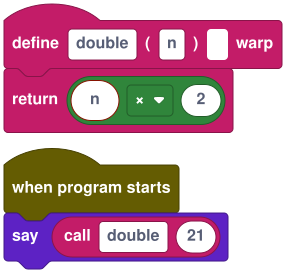</td></tr></table>

<!-- /generated -->

## Built-in variables

Values every program can read without declaring them. Sprite properties are written like variables; the others are reporters, called with `()`. *One value for* says who has their own copy: each sprite and clone, a sprite with its clones, or the whole program.

<!-- generated: built-in-variables -->

| Name | Type | One value for | Access | What it is |
|---|---|---|---|---|
| [`x`](#x--sprite-property) | number | each sprite and clone | read and write | The sprite's x position. |
| [`y`](#y--sprite-property) | number | each sprite and clone | read and write | The sprite's y position. |
| [`direction`](#direction--sprite-property) | number | each sprite and clone | read and write | Where the sprite points, in degrees: 0 is up, 90 is right, -90 is left. |
| [`size`](#size--sprite-property) | number | each sprite and clone | read and write | The sprite's size in percent of its costume (100 is the costume's own size). |
| [`costume_number`](#costume_number--sprite-property) | number | each sprite and clone | read-only | The number of the sprite's costume, from 1. |
| [`on_edge()`](#on_edge--reporter) | string | each sprite and clone | read-only | The edge the sprite's box crosses: `"left"`, `"right"`, `"top"`, `"bottom"`, or `""` when it's inside ([D3](departures.md)). |
| [`volume()`](#volume--reporter) | number | the whole program | read-only | The current volume. |
| [`timer()`](#timer--reporter) | number | the whole program | read-only | Seconds since **Run** or the last `reset_timer()`. |
| [`http_status()`](#http_status--reporter) | number | each sprite and clone | read-only | The HTTP status of this sprite's last finished request: `200`, `404` and so on, or `0` when there was no answer (not allowed, offline, blocked by CORS, timed out, or a reply over 1 MB). |
| [`costume_name()`](#costume_name--reporter) | string | each sprite and clone | read-only | The current costume's name. |
| [`is_clone()`](#is_clone--reporter) | boolean | each sprite and clone | read-only | True in a clone, false in the original sprite. |
| [`clone_count()`](#clone_count--reporter) | number | each sprite and its clones together | read-only | How many clones of this sprite exist now. |
| [`my_id()`](#my_id--reporter) | string | each sprite and clone | read-only | This sprite's id: its name, or `"Name#k"` in a clone. |
| [`mouse_x()`](#mouse_x--reporter) | number | the whole program | read-only | The pointer's x in stage coordinates. |
| [`mouse_y()`](#mouse_y--reporter) | number | the whole program | read-only | The pointer's y in stage coordinates. |
| [`mouse_down()`](#mouse_down--reporter) | boolean | the whole program | read-only | True while a mouse button (or a finger) is down on the stage. |
| [`touching_edge()`](#touching_edge--reporter) | boolean | each sprite and clone | read-only | True when the sprite's box reaches an edge of the stage. |
| [`touching_mouse()`](#touching_mouse--reporter) | boolean | each sprite and clone | read-only | True when the pointer is over an opaque pixel of the sprite. |
| [`delta_time()`](#delta_time--reporter) | number | the whole program | read-only | Seconds per tick: always 1/60, because Stitch runs at a fixed 60 ticks a second ([D28](departures.md)). |
| [`map_width()`](#map_width--reporter) | number | the whole program | read-only | The map's width in cells (0 without a map). |
| [`map_height()`](#map_height--reporter) | number | the whole program | read-only | The map's height in cells. |
| [`tile_size()`](#tile_size--reporter) | number | the whole program | read-only | The map's tile size in stage pixels. |
| [`answer()`](#answer--reporter) | string | the whole program | read-only | The last answer typed for `ask`: one for the whole program, empty until the first answer and after each **Run**. |
| [`stage_width()`](#stage_width--reporter) | number | the whole program | read-only | The stage's width in stage pixels, from **Cart → Stage** (480 by default). |
| [`stage_height()`](#stage_height--reporter) | number | the whole program | read-only | The stage's height in stage pixels (360 by default). |
| [`frame_count()`](#frame_count--reporter) | number | the whole program | read-only | How many ticks have run since **Run**: 0 in the first tick, then 60 a second. |

### `x` — sprite property

The sprite's x position. Setting it moves the sprite (and draws if the pen is down).

<table><tr><td>

<!-- example: x -->
```stitch
x += 5
```

</td><td>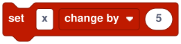</td></tr></table>

### `y` — sprite property

The sprite's y position. Up is positive on a stage whose y axis points up (the default).

<table><tr><td>

<!-- example: y -->
```stitch
if y < -150 then
  y = 150
end
```

</td><td>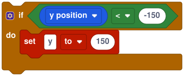</td></tr></table>

### `direction` — sprite property

Where the sprite points, in degrees: 0 is up, 90 is right, -90 is left.

<table><tr><td>

<!-- example: direction -->
```stitch
direction = 180
```

</td><td>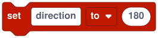</td></tr></table>

### `size` — sprite property

The sprite's size in percent of its costume (100 is the costume's own size).

<table><tr><td>

<!-- example: size -->
```stitch
size = size * 1.1
```

</td><td>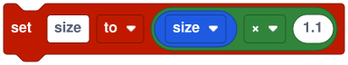</td></tr></table>

### `costume_number` — sprite property

The number of the sprite's costume, from 1. Read-only: change it with `costume()` or `next_costume()`.

<table><tr><td>

<!-- example: costume_number -->
```stitch
say(costume_number)
```

</td><td></td></tr></table>

<!-- /generated -->

## Events

Scripts start when their event fires. Several scripts can wait for the same event; each runs as its own thread. A script whose event fires again while it's running restarts from the top, as in Scratch. Events fired during a tick start on the next tick ([D6](departures.md)).

<!-- generated: events -->

### `on start do … end` — when program starts

Runs when you press **Run** (Scratch's green flag).

<table><tr><td>

<!-- example: on-start -->
```stitch
on start do
  goto(0, 0)
  say_for("Hello!", 2)
end
```

</td><td>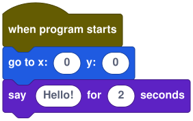</td></tr></table>

### `on key "k" do … end` — when key pressed

Runs each time a key is pressed. Key names are `"left"`, `"right"`, `"up"`, `"down"`, `"space"`, `"enter"`, `"escape"`, letters and digits ([D8](departures.md)).

<table><tr><td>

<!-- example: on-key -->
```stitch
on key "space" do
  next_costume()
end
```

</td><td>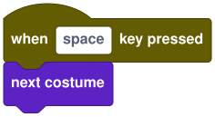</td></tr></table>

### `on message "m" do … end` — when I receive

Runs when any sprite or the stage broadcasts the message. See [Messages](#messages).

<table><tr><td>

<!-- example: on-message -->
```stitch
on message "game over" do
  hide()
end
```

</td><td>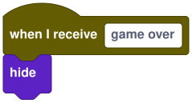</td></tr></table>

### `on clone do … end` — when I start as a clone

Runs in each new clone, from the tick after it's made. Only the clone runs it, not the sprite it was cloned from. See [Clones](#clones).

<table><tr><td>

<!-- example: on-clone -->
```stitch
on clone do
  goto(random(-200, 200), 180)
  show()
end
```

</td><td>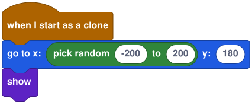</td></tr></table>

### `on click do … end` — when this sprite clicked

Runs when the sprite is clicked on stage. The topmost sprite under the pointer gets the click; in the Stage file, it runs when the click lands on no sprite.

<table><tr><td>

<!-- example: on-click -->
```stitch
on click do
  say_for("Ouch!", 1)
end
```

</td><td>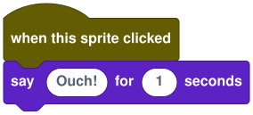</td></tr></table>

<!-- /generated -->

## Control

Loops run **one iteration per tick** (60 per second) unless they're in a [`warp function`](#warp-function--run-without-screen-refresh) ([D5](departures.md)). That keeps games at a steady speed and lets other scripts run between iterations.

<!-- generated: control -->

### `if … then … elseif … else … end`

Runs the first branch whose condition is true. `elseif` and `else` are optional; in blocks the gear adds them.

<table><tr><td>

<!-- example: if -->
```stitch
if score > 10 then
  say("Great!")
elseif score > 5 then
  say("Good")
else
  say("Keep going")
end
```

</td><td>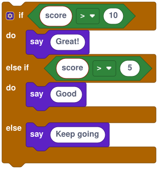 10 then say Great! else if score > 5 then say Good else say Keep going"></td></tr></table>

### `forever do … end`

Repeats until the script is stopped.

<table><tr><td>

<!-- example: forever -->
```stitch
forever do
  turn(3)
end
```

</td><td>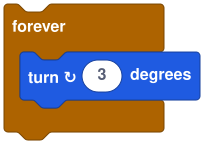</td></tr></table>

### `repeat n do … end`

Repeats `n` times (rounded).

<table><tr><td>

<!-- example: repeat -->
```stitch
repeat 10 do
  move(5)
end
```

</td><td>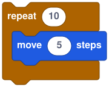</td></tr></table>

### `repeat until c do … end`

Repeats while `c` is false, checking before each iteration.

<table><tr><td>

<!-- example: repeat-until -->
```stitch
repeat until x > 200 do
  x += 4
end
```

</td><td>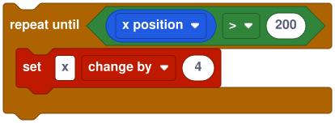 200: change x by 4"></td></tr></table>

### `while c do … end`

Repeats while `c` is true, checking before each iteration.

<table><tr><td>

<!-- example: while -->
```stitch
while key_down("space") do
  size += 1
end
```

</td><td>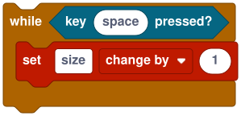</td></tr></table>

### `for i = a, b do … end` — count

Counts `i` from `a` to `b`, both included, in steps of 1. `i` is local to the loop.

<table><tr><td>

<!-- example: for -->
```stitch
for i = 1, 5 do
  say(i)
  wait(0.5)
end
```

</td><td>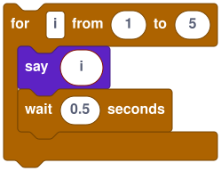</td></tr></table>

### `for i = a, b, step do … end` — count by

Counts with a step. A negative step counts down.

<table><tr><td>

<!-- example: for-step -->
```stitch
for i = 10, 0, -2 do
  say(i)
  wait(0.2)
end
```

</td><td>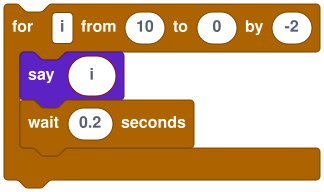</td></tr></table>

### `for item in list do … end` — for each

Runs once per item of a list (a copy taken when the loop starts), or once per character of a string.

<table><tr><td>

<!-- example: for-each -->
```stitch
for f in fruit do
  say_for(f, 1)
end
```

</td><td>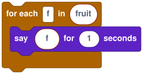</td></tr></table>

### `wait until c`

Waits until `c` is true, checking once per tick.

<table><tr><td>

<!-- example: wait-until -->
```stitch
wait until key_down("space")
say("Go!")
```

</td><td>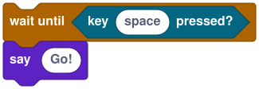</td></tr></table>

### `break`

Leaves the innermost loop. Like `return`, it must be the last statement of its block, so it usually sits in an `if` ([D30](departures.md)).

<table><tr><td>

<!-- example: break -->
```stitch
for i = 1, 100 do
  if tile_at(i * 8, 0) == 1 then
    break
  end
  set_tile(i * 8, 0, 2)
end
```

</td><td>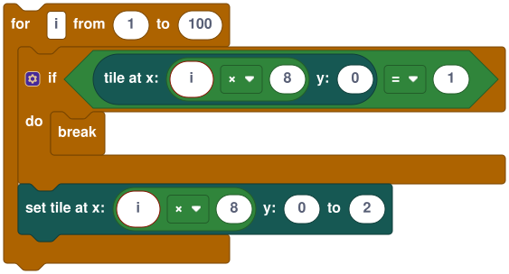</td></tr></table>

### `continue`

Skips the rest of this iteration. The loop still waits for the next tick before going round again (one iteration per tick, [D5](departures.md)). Like `break`, it ends its block.

<table><tr><td>

<!-- example: continue -->
```stitch
for item in items do
  if item == "" then
    continue
  end
  print(item)
end
```

</td><td>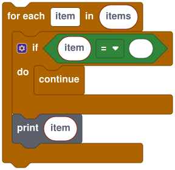</td></tr></table>

<!-- /generated -->

## Functions

<!-- generated: functions -->

### `function name(a, b) … end` — define

Defines a function in this file. Call it from any script in the same file. Parameters are local. Functions are called as statements, or as values when they `return` one.

<table><tr><td>

<!-- example: function -->
```stitch
function jump(height)
  repeat 10 do
    y += height / 10
  end
  repeat 10 do
    y -= height / 10
  end
end
```

</td><td>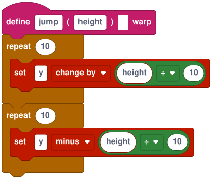</td></tr></table>

### `warp function` — run without screen refresh

A `warp` function runs its loops without waiting for the next tick, like Scratch's *run without screen refresh*. Functions it calls are warped too. It still pauses once a tick has run for 500 ms, so a runaway loop can't freeze the page ([D5](departures.md)).

<table><tr><td>

<!-- example: warp-function -->
```stitch
warp function fill_row(row)
  for col = 1, 30 do
    set_tile(col * 16, row * 16, 1)
  end
end
```

</td><td>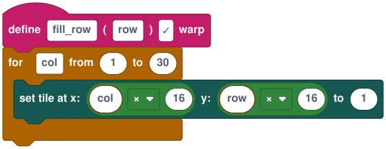</td></tr></table>

### `return` — return a value

Ends the function, reporting `value` (or `""` with no value). `return` must be the last statement of its block ([D12](departures.md)).

<table><tr><td>

<!-- example: return -->
```stitch
function double(n)
  return n * 2
end

function check()
  if x > 0 then
    return
  end
  say("left side")
end
```

</td><td>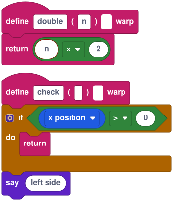 0 then return, say left side"></td></tr></table>

### Calling a function

A call is a statement when its result isn't used, and an expression when it is. In blocks, calls come from the **Functions** category with one slot per parameter ([D14](departures.md)).

<table><tr><td>

<!-- example: call -->
```stitch
on start do
  jump(40)
  say(double(21))
end

function jump(height)
  y += height
end

function double(n)
  return n * 2
end
```

</td><td>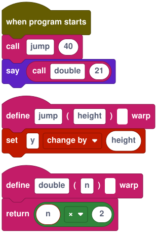</td></tr></table>

<!-- /generated -->

## Operators

From tightest to loosest binding: `^`, then unary `-` and `not`, then `*` `/` `%`, then `+` `-`, then `..`, then comparisons, then `and`, then `or`. Parentheses group as usual; blocks nest instead.

<!-- generated: operators -->

### `+ - * / % ^` — arithmetic

`%` is modulo, floored like Scratch's (`-1 % 3` is `2`). `^` is power and groups right to left.

<table><tr><td>

<!-- example: arith -->
```stitch
say(2 + 3 * 4)
say(17 % 5)
say(2 ^ 10)
```

</td><td>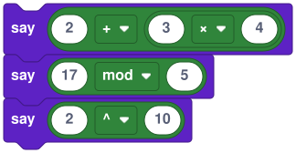</td></tr></table>

### `-x` — negate

Flips the sign of a number: `-x` is `0 - x`.

<table><tr><td>

<!-- example: neg -->
```stitch
x = -x
```

</td><td>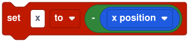</td></tr></table>

### `a .. b` — join

Joins two values as text.

<table><tr><td>

<!-- example: concat -->
```stitch
say("Score: " .. score)
```

</td><td>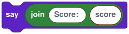</td></tr></table>

### `== ~= < <= > >=` — compare

`~=` is *not equal*. Numbers and numeric text compare as numbers; other text compares by characters, case-sensitively ([D7](departures.md)).

<table><tr><td>

<!-- example: compare -->
```stitch
if lives <= 0 then
  say("Game over")
end
if name ~= "" then
  say(name)
end
```

</td><td>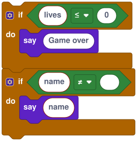</td></tr></table>

### `and`, `or`, `not`

Logic on truth values. `and` and `or` always give `true` or `false` ([D11](departures.md)).

<table><tr><td>

<!-- example: logic -->
```stitch
if key_down("left") and not key_down("right") then
  x -= 2
end
```

</td><td>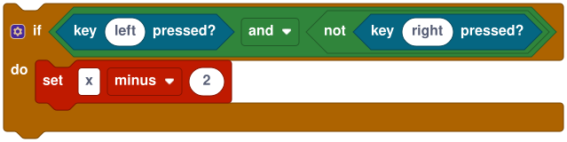</td></tr></table>

<!-- /generated -->

## Motion

Positions are in cart coordinates: by default the origin is the stage centre and y points up, as in Scratch, but each cart can change both in **Cart → Stage**. Directions are always visual: 0 points up and 90 points right ([D1](departures.md), [D2](departures.md)).

<!-- generated: motion -->

### `move(steps)` — command

Moves `steps` along the sprite's direction.

<table><tr><td>

<!-- example: move -->
```stitch
move(10)
```

</td><td></td></tr></table>

### `turn(degrees)` — command

Turns clockwise by `degrees`.

<table><tr><td>

<!-- example: turn -->
```stitch
turn(15)
```

</td><td></td></tr></table>

### `goto(x, y)` — command

Jumps to a position.

<table><tr><td>

<!-- example: goto -->
```stitch
goto(0, 0)
```

</td><td></td></tr></table>

### `point(direction)` — command

Sets the direction: 0 up, 90 right, 180 down, -90 left.

<table><tr><td>

<!-- example: point -->
```stitch
point(90)
```

</td><td></td></tr></table>

### `point_towards(x, y)` — command

Turns to face a position ([D10](departures.md)).

<table><tr><td>

<!-- example: point_towards -->
```stitch
point_towards(0, 0)
```

</td><td></td></tr></table>

### `bounce()` — command

If the sprite's box crosses an edge of the stage, reflects its direction away from that edge and moves it back on stage ([D3](departures.md)).

<table><tr><td>

<!-- example: bounce -->
```stitch
forever do
  move(4)
  bounce()
end
```

</td><td>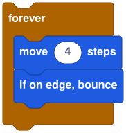</td></tr></table>

### `clamp_to_stage()` — command

Moves the sprite so its box is inside the stage. Stitch never does this by itself ([D1](departures.md)).

<table><tr><td>

<!-- example: clamp_to_stage -->
```stitch
x += 5
clamp_to_stage()
```

</td><td>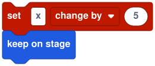</td></tr></table>

### `on_edge()` — reporter

The edge the sprite's box crosses: `"left"`, `"right"`, `"top"`, `"bottom"`, or `""` when it's inside ([D3](departures.md)).

<table><tr><td>

<!-- example: on_edge -->
```stitch
if on_edge() == "left" then
  vx = -vx
end
```

</td><td>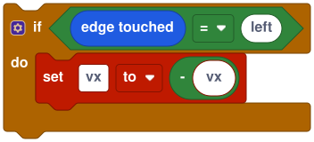</td></tr></table>

### `angle_to(x, y)` — reporter

The direction from the sprite to a position.

<table><tr><td>

<!-- example: angle_to -->
```stitch
point(angle_to(100, 50))
```

</td><td></td></tr></table>

### `distance_to(x, y)` — reporter

The distance from the sprite to a position.

<table><tr><td>

<!-- example: distance_to -->
```stitch
if distance_to(player_x, player_y) < 20 then
  say("Got you!")
end
```

</td><td></td></tr></table>

### `goto_random()` — command

Jumps to a random point on the stage.

<table><tr><td>

<!-- example: goto_random -->
```stitch
goto_random()
```

</td><td></td></tr></table>

### `goto_sprite(sprite)` — command

Jumps to another sprite's position. `sprite` is a name, a clone id from [`my_id`](#my_id--reporter), `"mouse"` or `"random"`.

<table><tr><td>

<!-- example: goto_sprite -->
```stitch
goto_sprite("Player")
```

</td><td></td></tr></table>

### `glide(seconds, x, y)` — command, waits

Moves smoothly to a position over `seconds`, in whole ticks like [`wait`](#waitseconds--command-waits) ([D4](departures.md)).

<table><tr><td>

<!-- example: glide -->
```stitch
glide(1, 100, 0)
```

</td><td></td></tr></table>

### `point_towards_sprite(sprite)` — command

Turns to face another sprite (or `"mouse"`).

<table><tr><td>

<!-- example: point_towards_sprite -->
```stitch
point_towards_sprite("Player")
```

</td><td></td></tr></table>

### `rotation_style(style)` — command

How the costume turns with direction: `"all around"` (the default), `"left-right"` (mirrors when facing left) or `"don't rotate"`.

<table><tr><td>

<!-- example: rotation_style -->
```stitch
rotation_style("left-right")
```

</td><td></td></tr></table>

<!-- /generated -->

## Looks

<!-- generated: looks -->

### `costume(costume)` — command

Switches to the costume named `costume`, or to costume number `costume` (from 1, wrapping around).

<table><tr><td>

<!-- example: costume -->
```stitch
costume("jump")
costume(1)
```

</td><td></td></tr></table>

### `next_costume()` — command

Switches to the next costume, wrapping to the first.

<table><tr><td>

<!-- example: next_costume -->
```stitch
forever do
  next_costume()
  wait(0.1)
end
```

</td><td></td></tr></table>

### `say(text)` — command

Shows a speech bubble until something else is said. `say("")` removes it.

<table><tr><td>

<!-- example: say -->
```stitch
say("Hello!")
```

</td><td></td></tr></table>

### `say_for(text, seconds)` — command, waits

Shows a speech bubble, waits, then removes it (unless something else was said meanwhile).

<table><tr><td>

<!-- example: say_for -->
```stitch
say_for("Hmm…", 2)
```

</td><td></td></tr></table>

### `show()` — command

Makes the sprite visible.

<table><tr><td>

<!-- example: show -->
```stitch
show()
```

</td><td></td></tr></table>

### `hide()` — command

Hides the sprite. Hidden sprites still run their scripts.

<table><tr><td>

<!-- example: hide -->
```stitch
hide()
```

</td><td></td></tr></table>

### `think(text)` — command

Shows a thought bubble. `think("")` removes it.

<table><tr><td>

<!-- example: think -->
```stitch
think("Hmm...")
```

</td><td></td></tr></table>

### `think_for(text, seconds)` — command, waits

Thinks for a while, then removes the bubble.

<table><tr><td>

<!-- example: think_for -->
```stitch
think_for("Hmm...", 2)
```

</td><td></td></tr></table>

### `costume_name()` — reporter

The current costume's name.

<table><tr><td>

<!-- example: costume_name -->
```stitch
say(costume_name())
```

</td><td></td></tr></table>

### `set_effect(effect, value)` — command

Sets a graphic effect: `"ghost"` (0–100, see-through), `"brightness"` (-100–100) or `"color"` (hue; 200 is a full turn).

<table><tr><td>

<!-- example: set_effect -->
```stitch
set_effect("ghost", 50)
```

</td><td></td></tr></table>

### `change_effect(effect, by)` — command

Changes a graphic effect by an amount.

<table><tr><td>

<!-- example: change_effect -->
```stitch
change_effect("color", 25)
```

</td><td></td></tr></table>

### `clear_effects()` — command

Turns every graphic effect off.

<table><tr><td>

<!-- example: clear_effects -->
```stitch
clear_effects()
```

</td><td></td></tr></table>

### `go_to_front()` — command

Draws the sprite in front of all others.

<table><tr><td>

<!-- example: go_to_front -->
```stitch
go_to_front()
```

</td><td></td></tr></table>

### `go_to_back()` — command

Draws the sprite behind all others (still in front of the pen and the map).

<table><tr><td>

<!-- example: go_to_back -->
```stitch
go_to_back()
```

</td><td></td></tr></table>

### `change_layer(by)` — command

Moves the sprite forward `by` layers, or back for a negative number.

<table><tr><td>

<!-- example: change_layer -->
```stitch
change_layer(-1)
```

</td><td></td></tr></table>

<!-- /generated -->

## Sound

Sounds and songs belong to the cart, not to a sprite, so any script can play any of them by name or by number (from 1) ([D16](departures.md)). Make them in the **Sounds** tab.

<!-- generated: sound -->

### `play_sound(sound)` — command

Starts a sound and carries on. Starting it again overlaps the first, up to 32 voices ([D17](departures.md)).

<table><tr><td>

<!-- example: play_sound -->
```stitch
play_sound("coin1")
```

</td><td></td></tr></table>

### `play_sound_wait(sound)` — command, waits

Plays a sound and waits for its length, measured in ticks ([D15](departures.md)).

<table><tr><td>

<!-- example: play_sound_wait -->
```stitch
play_sound_wait("jump1")
```

</td><td></td></tr></table>

### `stop_sounds()` — command

Stops every sound effect (not music).

<table><tr><td>

<!-- example: stop_sounds -->
```stitch
stop_sounds()
```

</td><td></td></tr></table>

### `play_music(song)` — command

Plays a tracker song, replacing any song already playing. Songs set to loop repeat until stopped ([D18](departures.md)).

<table><tr><td>

<!-- example: play_music -->
```stitch
play_music("theme")
```

</td><td></td></tr></table>

### `stop_music()` — command

Stops the song.

<table><tr><td>

<!-- example: stop_music -->
```stitch
stop_music()
```

</td><td></td></tr></table>

### `set_volume(percent)` — command

Sets the volume of all sounds and music, 0–100. **Run** resets it to 100.

<table><tr><td>

<!-- example: set_volume -->
```stitch
set_volume(50)
```

</td><td></td></tr></table>

### `volume()` — reporter

The current volume.

<table><tr><td>

<!-- example: volume -->
```stitch
set_volume(volume() - 10)
```

</td><td></td></tr></table>

### `change_volume(by)` — command

Changes the master volume by `by` percent.

<table><tr><td>

<!-- example: change_volume -->
```stitch
change_volume(-10)
```

</td><td></td></tr></table>

<!-- /generated -->

## Messages

Messages let scripts in different sprites start each other. Any text works as a message name.

<!-- generated: messages -->

### `broadcast(message)` — command

Starts every `on message` script for `message`, and carries on.

<table><tr><td>

<!-- example: broadcast -->
```stitch
broadcast("level up")
```

</td><td></td></tr></table>

### `broadcast_wait(message)` — command, waits

Starts them and waits until all of them have finished.

<table><tr><td>

<!-- example: broadcast_wait -->
```stitch
broadcast_wait("intro")
say("Let's go")
```

</td><td></td></tr></table>

<!-- /generated -->

## Timing

Time in Stitch is simulation time: 60 ticks per second, whatever the frame rate, so a game runs the same way every time ([D4](departures.md)).

<!-- generated: timing -->

### `wait(seconds)` — command, waits

Waits `round(seconds × 60)` ticks, at least one.

<table><tr><td>

<!-- example: wait -->
```stitch
wait(1)
```

</td><td></td></tr></table>

### `stop()` — command

Stops this script. Other scripts keep running.

<table><tr><td>

<!-- example: stop -->
```stitch
if lives == 0 then
  stop()
end
```

</td><td></td></tr></table>

### `timer()` — reporter

Seconds since **Run** or the last `reset_timer()`.

<table><tr><td>

<!-- example: timer -->
```stitch
if timer() > 30 then
  broadcast("time up")
end
```

</td><td> 30 then broadcast time up"></td></tr></table>

### `reset_timer()` — command

Sets the timer back to 0.

<table><tr><td>

<!-- example: reset_timer -->
```stitch
reset_timer()
```

</td><td></td></tr></table>

### `stop_all()` — command

Stops every script and deletes every clone, like Scratch's *stop all*. The **Stop** button does the same.

<table><tr><td>

<!-- example: stop_all -->
```stitch
if lives == 0 then
  stop_all()
end
```

</td><td></td></tr></table>

### `stop_other_scripts()` — command

Stops this sprite's other scripts and keeps this one running.

<table><tr><td>

<!-- example: stop_other_scripts -->
```stitch
stop_other_scripts()
```

</td><td></td></tr></table>

### `delta_time()` — reporter

Seconds per tick: always 1/60, because Stitch runs at a fixed 60 ticks a second ([D28](departures.md)). It's there so code written for a variable frame rate reads naturally.

<table><tr><td>

<!-- example: delta_time -->
```stitch
x += 120 * delta_time()
```

</td><td></td></tr></table>

### `frame_count()` — reporter

How many ticks have run since **Run**: 0 in the first tick, then 60 a second. Use it for animation that must stay in step, like blinking every 30 ticks ([D32](departures.md)).

<table><tr><td>

<!-- example: frame_count -->
```stitch
if frame_count() % 30 == 0 then
  next_costume()
end
```

</td><td></td></tr></table>

<!-- /generated -->

## Clones

A clone is a copy of a sprite, made while the game runs: bullets, enemies, particles. It starts with its parent's position, costume, effects and variables (lists and dictionaries are copied), runs the sprite's [`on clone`](#on-clone-do--end--when-i-start-as-a-clone) scripts, and answers broadcasts like any sprite. [`shared var`](#shared-var--shared-by-a-sprite-and-its-clones) gives a family one value to share.

Each clone has an id, the sprite's name and a number: `"Enemy#3"`. Blocks that take a sprite (`x_of`, `touching`, `var_of`…) accept a name, which means the original sprite, or an id, which means that clone.

A cart allows 300 clones at once by default (**Cart → Stage → Clone limit**). Making one more is an error that stops the script at that line, rather than silently doing nothing as Scratch does ([D25](departures.md)).

<!-- generated: clones -->

### `create_clone()` — command

Makes a clone of this sprite (or of this clone). It's drawn just behind its parent.

<table><tr><td>

<!-- example: create_clone -->
```stitch
repeat 5 do
  create_clone()
  x += 40
end
```

</td><td></td></tr></table>

### `create_clone_of(sprite)` — command

Makes a clone of another sprite by name (`"myself"` for this one). The stage can use it too.

<table><tr><td>

<!-- example: create_clone_of -->
```stitch
create_clone_of("Enemy")
```

</td><td></td></tr></table>

### `delete_clone()` — command

Deletes this clone and stops its scripts. Does nothing on an original sprite.

<table><tr><td>

<!-- example: delete_clone -->
```stitch
if y < -180 then
  delete_clone()
end
```

</td><td></td></tr></table>

### `is_clone()` — reporter

True in a clone, false in the original sprite.

<table><tr><td>

<!-- example: is_clone -->
```stitch
if not is_clone() then
  hide()
end
```

</td><td></td></tr></table>

### `clone_count()` — reporter

How many clones of this sprite exist now.

<table><tr><td>

<!-- example: clone_count -->
```stitch
say(clone_count())
```

</td><td></td></tr></table>

### `clones(sprite)` — reporter

The ids of a sprite's live clones, oldest first, as a list.

<table><tr><td>

<!-- example: clones -->
```stitch
for e in clones("Enemy") do
  print(e .. " is at " .. x_of(e))
end
```

</td><td></td></tr></table>

### `my_id()` — reporter

This sprite's id: its name, or `"Name#k"` in a clone.

<table><tr><td>

<!-- example: my_id -->
```stitch
print(my_id())
```

</td><td></td></tr></table>

<!-- /generated -->

## Sensing

<!-- generated: sensing -->

### `key_down(key)` — reporter

Whether a key is held down. Key names as in [`on key`](#on-key-k-do--end--when-key-pressed); `"any"` means any key.

<table><tr><td>

<!-- example: key_down -->
```stitch
if key_down("right") then
  x += 3
end
```

</td><td></td></tr></table>

### `key_pressed(key)` — reporter

True only on the tick the key went down, so holding it counts once. `key_down` is true for as long as it's held. Good for turn-based moves and menus.

<table><tr><td>

<!-- example: key_pressed -->
```stitch
if key_pressed("right") then
  x += 8
end
```

</td><td></td></tr></table>

### `mouse_x()` — reporter

The pointer's x in stage coordinates.

<table><tr><td>

<!-- example: mouse_x -->
```stitch
goto(mouse_x(), mouse_y())
```

</td><td></td></tr></table>

### `mouse_y()` — reporter

The pointer's y in stage coordinates.

<table><tr><td>

<!-- example: mouse_y -->
```stitch
print(mouse_y())
```

</td><td></td></tr></table>

### `mouse_down()` — reporter

True while a mouse button (or a finger) is down on the stage.

<table><tr><td>

<!-- example: mouse_down -->
```stitch
wait until mouse_down()
```

</td><td></td></tr></table>

### `touching(sprite)` — reporter

True when an opaque pixel of this sprite overlaps one of the other sprite (or of any of its clones, given a name). Also takes `"mouse"` and `"edge"`.

<table><tr><td>

<!-- example: touching -->
```stitch
if touching("Coin") then
  score += 1
end
```

</td><td></td></tr></table>

### `touching_edge()` — reporter

True when the sprite's box reaches an edge of the stage. [`on_edge`](#on_edge--reporter) says which one.

<table><tr><td>

<!-- example: touching_edge -->
```stitch
if touching_edge() then
  delete_clone()
end
```

</td><td></td></tr></table>

### `touching_mouse()` — reporter

True when the pointer is over an opaque pixel of the sprite.

<table><tr><td>

<!-- example: touching_mouse -->
```stitch
if touching_mouse() and mouse_down() then
  say("Got me")
end
```

</td><td></td></tr></table>

### `touching_color(color)` — reporter

True when the sprite is over the colour: on another sprite, the tile map or the stage background. `color` is `"#rrggbb"` or a palette number 1–16. Pen drawing doesn't count ([D27](departures.md)).

<table><tr><td>

<!-- example: touching_color -->
```stitch
if touching_color("#ff004d") then
  lives -= 1
end
```

</td><td></td></tr></table>

### `color_touching(color, other)` — reporter

True when a part of this sprite in `color` is over `other` ([D27](departures.md)).

<table><tr><td>

<!-- example: color_touching -->
```stitch
if color_touching("#ffec27", "#29adff") then
  say("splash")
end
```

</td><td></td></tr></table>

### `distance_to_sprite(sprite)` — reporter

The distance to another sprite (or `"mouse"`).

<table><tr><td>

<!-- example: distance_to_sprite -->
```stitch
if distance_to_sprite("Player") < 50 then
  point_towards_sprite("Player")
end
```

</td><td></td></tr></table>

### `sprite_at(x, y)` — reporter

The id of the topmost visible sprite with an opaque pixel at a point, or `""`.

<table><tr><td>

<!-- example: sprite_at -->
```stitch
local who = sprite_at(mouse_x(), mouse_y())
```

</td><td></td></tr></table>

### `x_of(sprite)` — reporter

Another sprite's x position (Scratch's *x position of*).

<table><tr><td>

<!-- example: x_of -->
```stitch
goto(x_of("Player"), y_of("Player") + 40)
```

</td><td></td></tr></table>

### `y_of(sprite)` — reporter

Another sprite's y position.

<table><tr><td>

<!-- example: y_of -->
```stitch
print(y_of("Player"))
```

</td><td></td></tr></table>

### `direction_of(sprite)` — reporter

Another sprite's direction.

<table><tr><td>

<!-- example: direction_of -->
```stitch
point(direction_of("Player"))
```

</td><td></td></tr></table>

### `costume_of(sprite)` — reporter

Another sprite's costume number.

<table><tr><td>

<!-- example: costume_of -->
```stitch
costume(costume_of("Player"))
```

</td><td></td></tr></table>

### `var_of(sprite, variable)` — reporter

Another sprite's variable (its own `var`, then its `shared var`). For `"stage"`, a stage or global variable. `""` when there's none.

<table><tr><td>

<!-- example: var_of -->
```stitch
if var_of("Player", "hp") <= 0 then
  broadcast("game over")
end
```

</td><td></td></tr></table>

### `ask(question)` — command, waits

Asks the player a question and waits for the answer, which `answer()` then reports. A visible sprite asks in its speech bubble; the stage and hidden sprites show the question above the answer field. Questions from several scripts take turns, in the order asked. The field sits over the bottom of the stage, and keys typed into it don't start `on key` scripts ([D32](departures.md)).

<table><tr><td>

<!-- example: ask -->
```stitch
ask("What's your name?")
say("Hello, " .. answer())
```

</td><td></td></tr></table>

### `answer()` — reporter

The last answer typed for `ask`: one for the whole program, empty until the first answer and after each **Run**.

<table><tr><td>

<!-- example: answer -->
```stitch
ask("How many?")
repeat answer() do
  create_clone()
end
```

</td><td></td></tr></table>

### `stage_width()` — reporter

The stage's width in stage pixels, from **Cart → Stage** (480 by default).

<table><tr><td>

<!-- example: stage_width -->
```stitch
goto(random(-stage_width() / 2, stage_width() / 2), 0)
```

</td><td></td></tr></table>

### `stage_height()` — reporter

The stage's height in stage pixels (360 by default).

<table><tr><td>

<!-- example: stage_height -->
```stitch
if y > stage_height() / 2 then
  y = -stage_height() / 2
end
```

</td><td> stage height / 2 then set y to -stage height / 2"></td></tr></table>

<!-- /generated -->

## Map

The tile map is a grid drawn behind every sprite, anchored at the stage's top-left corner (make one in the **Map** tab). Tile numbers count from 1 in the tileset, reading left to right, and 0 is empty. Both builtins take cart coordinates, so a sprite can pass its own `x` and `y`.

<!-- generated: map -->

### `tile_at(x, y)` — reporter

The tile at a position, or 0 when it's empty, off the map, or there is no map.

<table><tr><td>

<!-- example: tile_at -->
```stitch
if tile_at(x, y - 16) == 1 then
  say("On the ground")
end
```

</td><td></td></tr></table>

### `set_tile(x, y, tile)` — command

Changes the tile at a position. Off the map, it does nothing.

<table><tr><td>

<!-- example: set_tile -->
```stitch
set_tile(x, y, 0)
```

</td><td></td></tr></table>

### `map_cell(column, row)` — reporter

The tile at a map cell, counting columns and rows from 1 at the top-left. 0 is empty or off the map.

<table><tr><td>

<!-- example: map_cell -->
```stitch
if map_cell(3, 4) == 1 then
  say("wall")
end
```

</td><td></td></tr></table>

### `set_map_cell(column, row, tile)` — command

Changes the tile at a map cell (0 clears it). Off the map, nothing happens.

<table><tr><td>

<!-- example: set_map_cell -->
```stitch
set_map_cell(3, 4, 2)
```

</td><td></td></tr></table>

### `map_width()` — reporter

The map's width in cells (0 without a map).

<table><tr><td>

<!-- example: map_width -->
```stitch
print(map_width())
```

</td><td></td></tr></table>

### `map_height()` — reporter

The map's height in cells.

<table><tr><td>

<!-- example: map_height -->
```stitch
print(map_height())
```

</td><td></td></tr></table>

### `tile_size()` — reporter

The map's tile size in stage pixels.

<table><tr><td>

<!-- example: tile_size -->
```stitch
goto(col * tile_size(), row * tile_size())
```

</td><td></td></tr></table>

<!-- /generated -->

## Pen

The pen draws onto a layer above the tile map and below the sprites, like Scratch's pen. Shapes use the calling sprite's pen colour, size and transparency, and take stage coordinates, so they follow the cart's origin and y axis. Rectangles are given by two opposite corners, which reads the same whichever way y points ([D24](departures.md)). On a stage with pixel filtering, the pen draws in whole stage pixels, matching pixel-art costumes.

<!-- generated: pen -->

### `pen_down()` — command

Starts drawing: the sprite leaves a line wherever it moves, and a dot where it is.

<table><tr><td>

<!-- example: pen_down -->
```stitch
pen_down()
move(100)
pen_up()
```

</td><td></td></tr></table>

### `pen_up()` — command

Stops drawing.

<table><tr><td>

<!-- example: pen_up -->
```stitch
pen_up()
```

</td><td></td></tr></table>

### `clear_pen()` — command

Erases everything the pen has drawn.

<table><tr><td>

<!-- example: clear_pen -->
```stitch
clear_pen()
```

</td><td></td></tr></table>

### `stamp()` — command

Draws the sprite's current look onto the pen layer.

<table><tr><td>

<!-- example: stamp -->
```stitch
repeat 6 do
  stamp()
  turn(60)
end
```

</td><td></td></tr></table>

### `set_pen_color(color)` — command

Sets the pen colour: `"#rrggbb"` or a palette number 1–16.

<table><tr><td>

<!-- example: set_pen_color -->
```stitch
set_pen_color("#29adff")
```

</td><td></td></tr></table>

### `change_pen_color(by)` — command

Shifts the pen's hue. 100 is a full turn of the colour wheel, as in Scratch.

<table><tr><td>

<!-- example: change_pen_color -->
```stitch
change_pen_color(10)
```

</td><td></td></tr></table>

### `set_pen_size(size)` — command

Sets the line width in stage pixels (1–1200). [`draw_text`](#draw_texttext-x-y--command) uses it as its scale.

<table><tr><td>

<!-- example: set_pen_size -->
```stitch
set_pen_size(4)
```

</td><td></td></tr></table>

### `change_pen_size(by)` — command

Changes the pen size.

<table><tr><td>

<!-- example: change_pen_size -->
```stitch
change_pen_size(1)
```

</td><td></td></tr></table>

### `set_pen_transparency(percent)` — command

0 is solid, 100 is invisible.

<table><tr><td>

<!-- example: set_pen_transparency -->
```stitch
set_pen_transparency(50)
```

</td><td></td></tr></table>

### `change_pen_transparency(by)` — command

Changes the pen transparency.

<table><tr><td>

<!-- example: change_pen_transparency -->
```stitch
change_pen_transparency(10)
```

</td><td></td></tr></table>

### `draw_line(x1, y1, x2, y2)` — command

Draws a line between two points.

<table><tr><td>

<!-- example: draw_line -->
```stitch
draw_line(-100, 0, 100, 0)
```

</td><td></td></tr></table>

### `draw_rect(x1, y1, x2, y2)` — command

Draws a rectangle's outline between two opposite corners.

<table><tr><td>

<!-- example: draw_rect -->
```stitch
draw_rect(-50, -30, 50, 30)
```

</td><td></td></tr></table>

### `fill_rect(x1, y1, x2, y2)` — command

Fills a rectangle between two opposite corners.

<table><tr><td>

<!-- example: fill_rect -->
```stitch
fill_rect(0, 0, 8, 8)
```

</td><td></td></tr></table>

### `draw_circle(x, y, radius)` — command

Draws a circle's outline.

<table><tr><td>

<!-- example: draw_circle -->
```stitch
draw_circle(0, 0, 40)
```

</td><td></td></tr></table>

### `fill_circle(x, y, radius)` — command

Fills a circle.

<table><tr><td>

<!-- example: fill_circle -->
```stitch
fill_circle(0, 0, 40)
```

</td><td></td></tr></table>

### `draw_text(text, x, y)` — command

Writes text in Stitch's built-in 3×5 pixel font, with its top-left corner at (x, y). Letters are drawn as capitals, each font pixel is `pen size` stage pixels, and `\n` starts a new line. It's for HUDs and scores: crisp at any scale and the same in every player ([D31](departures.md)).

<table><tr><td>

<!-- example: draw_text -->
```stitch
set_pen_size(2)
draw_text("HP " .. hp, -230, 170)
```

</td><td></td></tr></table>

<!-- /generated -->

## Math

Trigonometry uses degrees, and `sin(180)` is exactly 0, as in Scratch.

<!-- generated: math -->

### `abs(x)` — reporter

Absolute value.

<table><tr><td>

<!-- example: abs -->
```stitch
say(abs(-5))
```

</td><td></td></tr></table>

### `floor(x)` — reporter

Rounds down.

<table><tr><td>

<!-- example: floor -->
```stitch
say(floor(2.7))
```

</td><td></td></tr></table>

### `ceil(x)` — reporter

Rounds up.

<table><tr><td>

<!-- example: ceil -->
```stitch
say(ceil(2.1))
```

</td><td></td></tr></table>

### `round(x)` — reporter

Rounds to the nearest whole number.

<table><tr><td>

<!-- example: round -->
```stitch
say(round(2.5))
```

</td><td></td></tr></table>

### `sqrt(x)` — reporter

Square root.

<table><tr><td>

<!-- example: sqrt -->
```stitch
say(sqrt(16))
```

</td><td></td></tr></table>

### `sin(degrees)` — reporter

Sine.

<table><tr><td>

<!-- example: sin -->
```stitch
y = sin(timer() * 90) * 50
```

</td><td></td></tr></table>

### `cos(degrees)` — reporter

Cosine.

<table><tr><td>

<!-- example: cos -->
```stitch
x = cos(timer() * 90) * 50
```

</td><td></td></tr></table>

### `tan(degrees)` — reporter

Tangent.

<table><tr><td>

<!-- example: tan -->
```stitch
say(tan(45))
```

</td><td></td></tr></table>

### `min(a, b)` — reporter

The smaller value.

<table><tr><td>

<!-- example: min -->
```stitch
speed = min(speed + 1, 10)
```

</td><td></td></tr></table>

### `max(a, b)` — reporter

The larger value.

<table><tr><td>

<!-- example: max -->
```stitch
lives = max(lives - 1, 0)
```

</td><td></td></tr></table>

### `random(from, to)` — reporter

A random number between `from` and `to`, both included. Whole numbers when both are whole, decimals otherwise. Each Run gets a new random seed.

<table><tr><td>

<!-- example: random -->
```stitch
goto(random(-200, 200), random(-150, 150))
```

</td><td></td></tr></table>

### `random_int(from, to)` — reporter

A random whole number from `from` to `to`, both included, whatever kind of numbers you give it.

<table><tr><td>

<!-- example: random_int -->
```stitch
local roll = random_int(1, 6)
```

</td><td></td></tr></table>

### `set_seed(seed)` — command

Restarts the random numbers from a seed, so `random` and `random_int` give the same sequence every run. Handy for levels you want to share or test.

<table><tr><td>

<!-- example: set_seed -->
```stitch
set_seed(1234)
```

</td><td></td></tr></table>

### `clamp(x, low, high)` — reporter

`x`, kept between `low` and `high`.

<table><tr><td>

<!-- example: clamp -->
```stitch
hp = clamp(hp + 5, 0, max_hp)
```

</td><td></td></tr></table>

### `lerp(a, b, t)` — reporter

The value `t` of the way from `a` to `b` (`t` = 0 gives `a`, 1 gives `b`).

<table><tr><td>

<!-- example: lerp -->
```stitch
x = lerp(x, target_x, 0.1)
```

</td><td></td></tr></table>

### `sign(x)` — reporter

1 for positive numbers, -1 for negative, 0 for zero.

<table><tr><td>

<!-- example: sign -->
```stitch
x += sign(dx)
```

</td><td></td></tr></table>

### `distance(x1, y1, x2, y2)` — reporter

The distance between two points.

<table><tr><td>

<!-- example: distance -->
```stitch
print(distance(0, 0, 30, 40))
```

</td><td></td></tr></table>

### `angle(x1, y1, x2, y2)` — reporter

The direction from the first point to the second, in Scratch's convention (0 up, 90 right).

<table><tr><td>

<!-- example: angle -->
```stitch
point(angle(x, y, 0, 0))
```

</td><td></td></tr></table>

### `asin(x)` — reporter

Arcsine, in degrees.

<table><tr><td>

<!-- example: asin -->
```stitch
print(asin(1))
```

</td><td></td></tr></table>

### `acos(x)` — reporter

Arccosine, in degrees.

<table><tr><td>

<!-- example: acos -->
```stitch
print(acos(1))
```

</td><td></td></tr></table>

### `atan(x)` — reporter

Arctangent, in degrees.

<table><tr><td>

<!-- example: atan -->
```stitch
print(atan(1))
```

</td><td></td></tr></table>

### `ln(x)` — reporter

Natural logarithm.

<table><tr><td>

<!-- example: ln -->
```stitch
print(ln(1))
```

</td><td></td></tr></table>

### `log(x)` — reporter

Logarithm base 10.

<table><tr><td>

<!-- example: log -->
```stitch
print(log(100))
```

</td><td></td></tr></table>

### `exp(x)` — reporter

e to the power x.

<table><tr><td>

<!-- example: exp -->
```stitch
print(exp(1))
```

</td><td></td></tr></table>

### `pow10(x)` — reporter

10 to the power x.

<table><tr><td>

<!-- example: pow10 -->
```stitch
print(pow10(3))
```

</td><td></td></tr></table>

<!-- /generated -->

## Lists and text

Lists count from 1. Indexes out of range read `""` and writes there do nothing, as in Scratch.

<!-- generated: lists-and-text -->

### `len(value)` — reporter

The number of items in a list, keys in a dictionary, or characters in text.

<table><tr><td>

<!-- example: len -->
```stitch
say(len(fruit))
```

</td><td></td></tr></table>

### `push(list, item)` — command

Adds an item to the end of a list.

<table><tr><td>

<!-- example: push -->
```stitch
push(fruit, "kiwi")
```

</td><td></td></tr></table>

### `insert(list, index, item)` — command

Inserts an item at position `index`, moving later items along. `index` can be one past the end.

<table><tr><td>

<!-- example: insert -->
```stitch
insert(fruit, 1, "lime")
```

</td><td></td></tr></table>

### `remove(list, index)` — command

Deletes item `index` of a list, or key `index` of a dictionary.

<table><tr><td>

<!-- example: remove -->
```stitch
remove(fruit, 1)
```

</td><td></td></tr></table>

### `contains(value, item)` — reporter

Whether a list has the item (compared like `==`), a dictionary has the key, or text contains other text (case-sensitive).

<table><tr><td>

<!-- example: contains -->
```stitch
if contains(fruit, "fig") then
  say("Figs!")
end
```

</td><td></td></tr></table>

### `clear(list)` — command

Deletes every item of a list, or every key of a dictionary.

<table><tr><td>

<!-- example: clear -->
```stitch
clear(items)
```

</td><td></td></tr></table>

### `index_of(list, item)` — reporter

Where `item` first appears in the list, from 1, or 0 when it isn't there.

<table><tr><td>

<!-- example: index_of -->
```stitch
print(index_of(["a", "b"], "b"))
```

</td><td></td></tr></table>

<!-- /generated -->

## Text

Text joins with [`..`](#a--b--join); `s[i]` is a letter and `len(s)` the length.

<!-- generated: text -->

### `split(text, separator)` — reporter

A list of the pieces of `text` between separators. An empty separator splits into letters.

<table><tr><td>

<!-- example: split -->
```stitch
local words = split("a b c", " ")
```

</td><td></td></tr></table>

### `join(list, separator)` — reporter

The items of a list as one text, with `separator` between them.

<table><tr><td>

<!-- example: join -->
```stitch
say(join(["a", "b"], ", "))
```

</td><td></td></tr></table>

### `substring(text, from, to)` — reporter

Letters `from` to `to` of `text`, counting from 1 and including both ends.

<table><tr><td>

<!-- example: substring -->
```stitch
say(substring("hello", 2, 4))
```

</td><td></td></tr></table>

### `upper(text)` — reporter

The text in capitals.

<table><tr><td>

<!-- example: upper -->
```stitch
say(upper(name))
```

</td><td></td></tr></table>

### `lower(text)` — reporter

The text in small letters.

<table><tr><td>

<!-- example: lower -->
```stitch
if lower(answer) == "yes" then
  say("OK")
end
```

</td><td></td></tr></table>

### `format_number(x, decimals)` — reporter

A number as text with a fixed number of decimals (0–20).

<table><tr><td>

<!-- example: format_number -->
```stitch
say(format_number(3.14159, 2))
```

</td><td></td></tr></table>

<!-- /generated -->

## Grids and dictionaries

A grid is a list of rows, so `g[y][x]` reads a cell and `g[y][x] = v` writes one. The helpers below take x first, like `tile_at`. A dictionary maps text keys to values: read and write it with `d["key"]`, delete with [`remove`](#removelist-index--command), and `for k in d` goes through its keys ([D30](departures.md)).

<!-- generated: grids-and-dictionaries -->

### `make_grid(width, height, value)` — reporter

A new grid of `height` rows, each `width` cells of `value`. At most 1,000,000 cells.

<table><tr><td>

<!-- example: make_grid -->
```stitch
local g = make_grid(16, 12, 0)
```

</td><td></td></tr></table>

### `cell(grid, x, y)` — reporter

The cell at column `x`, row `y` (from 1), or `""` outside the grid.

<table><tr><td>

<!-- example: cell -->
```stitch
if cell(g, 3, 2) == 1 then
  say("wall")
end
```

</td><td></td></tr></table>

### `set_cell(grid, x, y, value)` — command

Changes one cell. Outside the grid, nothing happens.

<table><tr><td>

<!-- example: set_cell -->
```stitch
set_cell(g, 3, 2, 1)
```

</td><td></td></tr></table>

### `grid_width(grid)` — reporter

The number of columns.

<table><tr><td>

<!-- example: grid_width -->
```stitch
print(grid_width(g))
```

</td><td></td></tr></table>

### `grid_height(grid)` — reporter

The number of rows.

<table><tr><td>

<!-- example: grid_height -->
```stitch
print(grid_height(g))
```

</td><td></td></tr></table>

### `fill_grid(grid, value)` — command

Sets every cell to `value`.

<table><tr><td>

<!-- example: fill_grid -->
```stitch
fill_grid(g, 0)
```

</td><td></td></tr></table>

### `dict()` — reporter

A new, empty dictionary.

<table><tr><td>

<!-- example: dict -->
```stitch
local stats = dict()
stats["hp"] = 10
stats["name"] = "orc"
say(stats["name"])
```

</td><td></td></tr></table>

### `keys(dict)` — reporter

A dictionary's keys, in the order they were added, as a list.

<table><tr><td>

<!-- example: keys -->
```stitch
for k in keys(stats) do
  print(k .. " = " .. stats[k])
end
```

</td><td></td></tr></table>

### `has_key(dict, key)` — reporter

True when the dictionary has the key.

<table><tr><td>

<!-- example: has_key -->
```stitch
if not has_key(stats, "hp") then
  stats["hp"] = 1
end
```

</td><td></td></tr></table>

<!-- /generated -->

## Data

HTTP goes through the editor, which asks before a cart first contacts a host and adds your secrets; exported games fetch directly and never have secrets. See [network.md](network.md) and the [export guide](export.md). JSON objects become dictionaries, arrays become lists, and anything missing reads as `""` ([D19](departures.md)–[D21](departures.md)).

<!-- generated: data -->

### `http_get(url)` — reporter, waits

Fetches `url` and reports the response body as text. The script waits until the reply arrives; other scripts keep running.

<table><tr><td>

<!-- example: http_get -->
```stitch
local page = http_get("https://example.com/data.json")
```

</td><td></td></tr></table>

### `http_post(url, body)` — reporter, waits

Sends `body` to `url` and reports the response body. A body that is valid JSON goes out as `application/json`, anything else as plain text.

<table><tr><td>

<!-- example: http_post -->
```stitch
local r = http_post("https://example.com/api", "{\"score\": 10}")
```

</td><td></td></tr></table>

### `http_status()` — reporter

The HTTP status of this sprite's last finished request: `200`, `404` and so on, or `0` when there was no answer (not allowed, offline, blocked by CORS, timed out, or a reply over 1 MB).

<table><tr><td>

<!-- example: http_status -->
```stitch
if http_status() == 200 then
  say("ok")
end
```

</td><td></td></tr></table>

### `json_get(json, path)` — reporter

Follows a dotted `path` into JSON text, a list or a dictionary. Numeric steps index arrays from 1. Arrays come back as lists, objects as dictionaries, and a missing step gives `""`. An empty path reads the whole value.

<table><tr><td>

<!-- example: json_get -->
```stitch
say(json_get(page, "items.1.name"))
```

</td><td></td></tr></table>

### `json_parse(text)` — reporter

Reads JSON text: an array becomes a list, an object a [dictionary](#grids-and-dictionaries), a number, string or boolean that value, and invalid JSON gives `""`.

<table><tr><td>

<!-- example: json_parse -->
```stitch
local scores = json_parse("[3, 1, 2]")
```

</td><td></td></tr></table>

<!-- /generated -->

## Debug

<!-- generated: debug -->

### `print(value)` — command

Writes a line to the editor's **Console** (and the browser console in exported games), prefixed with the sprite's name.

<table><tr><td>

<!-- example: print -->
```stitch
print("x is " .. x)
```

</td><td></td></tr></table>

### `watch(label, value)` — command

Shows `label: value` in a monitor at the top-left of the stage, updated each time it runs. Scratch's variable checkboxes do this automatically; in Stitch you choose what to watch ([D29](departures.md)).

<table><tr><td>

<!-- example: watch -->
```stitch
forever do
  watch("score", score)
end
```

</td><td></td></tr></table>

### `assert(condition, message)` — command

Stops the script with an error when `condition` is false, pointing at this line. Use it to catch mistakes early.

<table><tr><td>

<!-- example: assert -->
```stitch
assert(hp >= 0, "hp went negative")
```

</td><td>= 0 else hp went negative"></td></tr></table>

<!-- /generated -->

## Raw code

Text that doesn't parse is kept exactly as written, as a grey **code** block, so a typo never loses work. The program won't run until it's fixed; **Problems** shows where. A whole line at the top level becomes a top-level code block; a broken line inside a script becomes a statement.

<!-- generated: raw-code -->

### Raw code

<table><tr><td>

<!-- example: raw -->
```stitch
on start do
  move(10
end

function (
```

</td><td></td></tr></table>

<!-- /generated -->

## Music effects

The tracker's effect column takes a letter or digit and two hex digits, as in classic trackers. Effects apply on each of the row's 6 ticks; anything else is kept but ignored.

| Effect | Meaning |
|---|---|
| `0xy` | Arpeggio: cycles the note, +x and +y semitones |
| `1xx` | Slide up, xx/16 semitone per tick |
| `2xx` | Slide down, xx/16 semitone per tick |
| `4xy` | Vibrato: speed x, depth y/8 semitone |
| `Axy` | Volume slide: up x or down y per tick |

## Keywords

| Keyword | Used in |
|---|---|
| `var` | [Variables](#var--sprite-variable) |
| `global` | [Global variables](#global-var--global-variable) |
| `shared` | [Shared variables](#shared-var--shared-by-a-sprite-and-its-clones) |
| `local` | [Local variables](#local--local-variable) |
| `function` | [Functions](#function-namea-b--end--define) |
| `warp` | [Warp functions](#warp-function--run-without-screen-refresh) |
| `return` | [Return](#return--return-a-value) |
| `on` | [Events](#events) |
| `start` | [`on start`](#on-start-do--end--when-program-starts) |
| `key` | [`on key`](#on-key-k-do--end--when-key-pressed) |
| `message` | [`on message`](#on-message-m-do--end--when-i-receive) |
| `clone` | [`on clone`](#on-clone-do--end--when-i-start-as-a-clone) |
| `click` | [`on click`](#on-click-do--end--when-this-sprite-clicked) |
| `do` | Starts the body of an event, loop or function |
| `end` | Ends a block |
| `if` | [If](#if--then--elseif--else--end) |
| `then` | [If](#if--then--elseif--else--end) |
| `elseif` | [If](#if--then--elseif--else--end) |
| `else` | [If](#if--then--elseif--else--end) |
| `forever` | [Forever](#forever-do--end) |
| `repeat` | [Repeat](#repeat-n-do--end), [repeat until](#repeat-until-c-do--end) |
| `until` | [Repeat until](#repeat-until-c-do--end), [wait until](#wait-until-c) |
| `while` | [While](#while-c-do--end) |
| `for` | [Count](#for-i--a-b-do--end--count), [for each](#for-item-in-list-do--end--for-each) |
| `in` | [For each](#for-item-in-list-do--end--for-each) |
| `break` | [Break](#break) |
| `continue` | [Continue](#continue) |
| `wait` | [Wait until](#wait-until-c) (`wait(s)` is a [builtin](#waitseconds--command-waits)) |
| `and` | [Logic](#and-or-not) |
| `or` | [Logic](#and-or-not) |
| `not` | [Logic](#and-or-not) |
| `true` | [Values](#values) |
| `false` | [Values](#values) |

`start`, `key`, `message`, `clone`, `click`, `shared`, `warp` and `wait` are only keywords where the grammar expects them, so they also work as ordinary names (`var key = "a"`).
