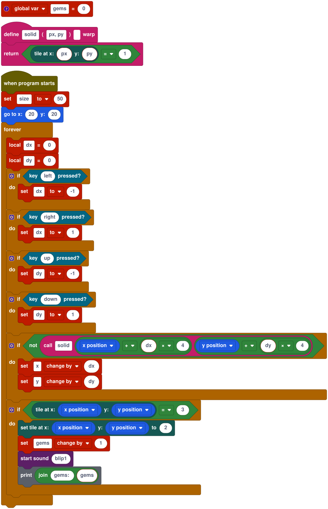

# Your first game: for PICO-8 users

You'll build **Gem Dash**: a little explorer walks a tile map, can't pass through walls, and digs up gems. It takes about 20 minutes, and you'll write it as text.

Stitch borrows a lot from PICO-8: a cart is one file holding code, sprites, map, sounds and music, saved as a PNG that shows the game's cover; there's a fixed 16-colour palette, an sfxr-style sound editor and a tracker. The language is Lua-flavoured (`--` comments, `local`, `~=`, `..`, `end`). What's different:

- **No `_update`/`_draw` loop.** Scripts start on events (`on start do`, `on key "x" do`) and loop with `forever`. Each loop iteration waits for the next frame, 60 a second, so many scripts run side by side like coroutines ([D5](../departures.md)).
- **No `spr` or `cls`.** Sprites are objects with a position and costumes, and the stage redraws them for you.
- **Blocks too.** Every line of text is also a block, so you can switch to the block view at any time.

## 1. A PICO-8-sized stage

Open the editor (`pnpm dev` in a checkout, then `http://localhost:5173`). On the **Cart** tab:

1. **New cart**, and confirm. Set **Title** to `Gem Dash`.
2. Under **Stage**, set **Width** and **Height** to `128`, **Origin** to *top-left*, **Y axis** to *down (screen)*, **Scaling** to *whole numbers only* and **Filtering** to *pixel (everything sharp)*.

Now (0, 0) is the top-left corner, y grows downwards, and the stage scales up in whole steps with crisp pixels, as on PICO-8. Directions stay visual: 90 still points right.

## 2. Draw the explorer

Open **Costumes**. **Sprite1** has a 16×16 circle in the pixel editor. Redraw it as you like with **Pencil**, **Fill** and the palette: it's PICO-8's palette, numbered from 1 (0 is transparent). The status line under the canvas shows the pixel under the pointer. **Center** sets the costume's centre: the point that sits at the sprite's `x` and `y` and that it turns around.

## 3. Make a map

Open **Map**. Choose **Tile size** *8px*, keep **Tileset** on *New starter tileset*, and press **Create map**. The starter tileset has four tiles: **1** brick, **2** grass, **3** stone, **4** water.

1. Click tile **2** (grass) and paint the whole floor (drag with the mouse).
2. Click tile **1** (brick) and paint a wall around the edge, plus a few walls inside.
3. Click tile **3** (stone) and dot a handful of stones around: these hide the gems.

The map is 16×16 tiles, filling the stage. Tiles are numbered from 1 in the tileset, and 0 means empty.

## 4. Write the code

Open **Code**, choose **Text**, and select **Sprite1**. Replace its text with:

<!-- example: tut-pico8-player -->
```stitch
-- Gem Dash: walk with the arrow keys, dig up the gems.
global var gems = 0

function solid(px, py)
  return tile_at(px, py) == 1
end

on start do
  size = 50
  goto(20, 20)
  forever do
    local dx = 0
    local dy = 0
    if key_down("left") then
      dx = -1
    end
    if key_down("right") then
      dx = 1
    end
    if key_down("up") then
      dy = -1
    end
    if key_down("down") then
      dy = 1
    end
    if not solid(x + dx * 4, y + dy * 4) then
      x += dx
      y += dy
    end
    if tile_at(x, y) == 3 then
      set_tile(x, y, 2)
      gems += 1
      play_sound("blip1")
      print("gems: " .. gems)
    end
  end
end
```

What's going on:

- `size = 50` halves the 16-pixel costume to 8 pixels, one tile.
- `solid` looks 4 pixels ahead (half the sprite) for a brick, the way you'd call `fget(mget(…))` in PICO-8. `tile_at` and `set_tile` take stage coordinates, so the sprite's own `x` and `y` work directly.
- Stone under the explorer turns into grass and counts a gem.
- `print` writes to the **Console** under the stage, like `printh`.

The editor checks as you type: problems are underlined and listed under **Problems**, with links to the line. How you indent doesn't matter: **Format** (⇧⌥F) tidies the text, and saving the cart formats it too. Switch to **Split** to see the same program as blocks:



## 5. Add a sound

Open **Sounds** and, under **New sound**, click **Blip**. That makes `blip1`, an sfxr preset you can tweak with the sliders, **Randomize** or **Mutate**. (**Music** next to **Effects** is a four-channel tracker, for later.)

## 6. Run it

Press **Run**, click the stage, and walk around. Walls stop you; each stone you step on turns to grass and prints a gem count. Press **Stop** to stop, and **Run** again to restart from the cart's starting state. The keys are ⌘↩ for Run, ⌘P for Pause and ⌘. for Stop (Ctrl on Windows and Linux), and they work while the stage has the keyboard too.

## 7. Save the cart

**Cart → Save .stitch.png** downloads `gem-dash.stitch.png`: the cover is the game's first frame, and the whole cart is inside the PNG, as with a `.p8.png`. Open it again with **Open file…** or by dropping it on the editor, or open any cart on the web with `?cart=URL`. The format is in [cart-format.md](../cart-format.md).

To share it as a game, **Cart → Export → HTML file** gives a single page that runs anywhere ([export guide](../export.md)).

## Where next

- Count down: give the player 30 seconds with `timer()` and `broadcast`, as in the [Scratch tutorial](first-game-scratch.md).
- Add a goal: when `gems == 5`, `say("You win!")`.
- Write a tune in **Sounds → Music** and start it with `play_music`.
- Every builtin is in the [language reference](../reference.md).
