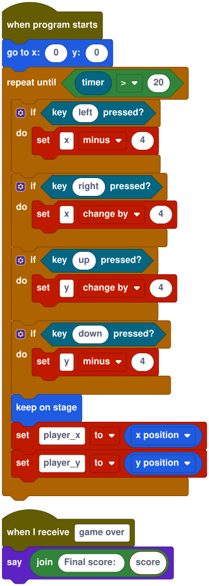
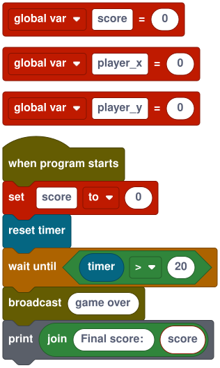
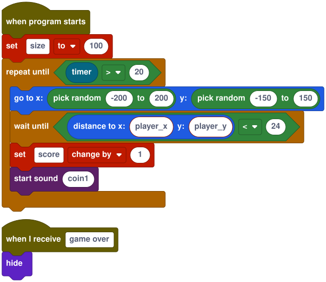

# Your first game: for Scratch users

You'll build **Coin Catcher**: steer a player with the arrow keys and grab as many coins as you can in 20 seconds. It takes about 15 minutes. You'll use blocks the whole way, and see the text Stitch writes alongside them.

If you know Scratch, most of Stitch will feel familiar: sprites, costumes, hat blocks, *forever*, *broadcast*. The differences that matter here are noted as they come up; all of them are in [departures.md](../departures.md).

## 1. Start a new cart

Open the editor (run `pnpm dev` in a checkout and go to `http://localhost:5173`, or use a hosted copy).

1. Click the **Cart** tab, then **New cart**, and confirm.
2. Set **Title** to `Coin Catcher`.

A cart is a whole project in one file, like an `.sb3`. The new one has the **Stage** and one sprite, **Sprite1**, a red circle.

## 2. Name the player

Back on the **Code** tab, double-click the **Sprite1** tab, type `Player` and press **Rename**.

The view buttons at the top choose **Blocks**, **Split** or **Text**. Choose **Split**: blocks on the left, the same program as text on the right. Change either side and the other follows.

## 3. Make the player move

With **Player** selected, build this script. Drag the blocks from the toolbox on the left:

- **when program starts** is in **Events**, and **go to x: y:** in **Motion**.
- **repeat until**, **if** and the comparison are in **Control** and **Operators**. **timer** is in **Sensing**.
- **key pressed?** is in **Sensing**. Click its slot and type `left`.
- **set** is in **Variables**. Type the variable's name (`x`) into the block, and pick **change by** from its dropdown.
- **keep on stage** is in **Motion**.

<!-- example: tut-scratch-player -->
```stitch
on start do
  goto(0, 0)
  repeat until timer() > 20 do
    if key_down("left") then
      x -= 4
    end
    if key_down("right") then
      x += 4
    end
    if key_down("up") then
      y += 4
    end
    if key_down("down") then
      y -= 4
    end
    clamp_to_stage()
    player_x = x
    player_y = y
  end
end

on message "game over" do
  say("Final score: " .. score)
end
```



Things that differ from Scratch:

- Variables are typed into the block rather than picked from a list, and `x`, `y`, `direction` and `size` are set the same way as variables ([D13](../departures.md)).
- A loop runs one step per frame (60 a second), so `x += 4` per step is a steady 240 pixels a second ([D5](../departures.md)).
- Sprites aren't kept on the stage automatically; **keep on stage** does it when you want it ([D1](../departures.md)).

`player_x`, `player_y` and `score` don't exist yet, so **Problems** lists them. That's next.

## 4. Share the player's position

The coin needs to know where the player is. Scratch would use a sensing block; in Stitch, sprites share **global variables**. Click the **Stage** tab and add:

<!-- example: tut-scratch-stage -->
```stitch
global var score = 0
global var player_x = 0
global var player_y = 0

on start do
  score = 0
  reset_timer()
  wait until timer() > 20
  broadcast("game over")
  print("Final score: " .. score)
end
```



The variable blocks are in **Variables**, **wait until** in **Control**, **broadcast** in **Events** and **print** in **Debug**. `print` writes to the **Console** under the stage, which is handy for checking a game.

**Problems** should now say *No problems*.

## 5. Add the coin

1. Click **Sprite** (the button with a plus). The new sprite gets the first free name, **Sprite1** again; double-click its tab and rename it `Coin`.
2. Open the **Costumes** tab. The coin's costume is a red circle in the pixel editor. Pick **Fill**, click the yellow swatch (colour 11) in the palette, and click inside the circle.
3. Back on **Code**, give the coin this script:

<!-- example: tut-scratch-coin -->
```stitch
on start do
  size = 100
  repeat until timer() > 20 do
    goto(random(-200, 200), random(-150, 150))
    wait until distance_to(player_x, player_y) < 24
    score += 1
    play_sound("coin1")
  end
end

on message "game over" do
  hide()
end
```



`distance to x: y:` measures to a point, so the coin uses the position the player shares ([D10](../departures.md)).

## 6. Make a sound

Open the **Sounds** tab. Under **New sound**, click **Coin**. Stitch makes a sound called `coin1` from the classic sfxr coin preset. Press **▶ Play** to hear it, and **Randomize** or **Mutate** until you like it. Sounds belong to the whole cart, so any sprite can play them by name ([D16](../departures.md)).

## 7. Play

Press **Run** at the top. Click the stage so it gets the keyboard, then chase coins with the arrow keys. After 20 seconds the coin disappears, the player says your score, and the **Console** shows it.

If something's wrong, **Problems** and the **Console** link to the line that caused it: click the link to jump there.

## 8. Save and share

- **Cart → Save .stitch.png** downloads the cart. It's a picture of your game with the whole project inside; open it again with **Open file…** or by dropping it on the editor.
- **Cart → Export → HTML file** makes a single page anyone can play in a browser, even offline. Put it on itch.io or any website ([export guide](../export.md)).

## Where next

- Add a second coin: right now a sprite can't be duplicated, so add a sprite and paste the coin's text into it.
- Make the player face where it's going with `point(90)` and `point(-90)`, and give it a second costume.
- Show the score live with `say("Score: " .. score)` inside the player's loop.
- Read the [language reference](../reference.md) for every block, and try the [PICO-8 tutorial](first-game-pico8.md) for the text side of Stitch.
